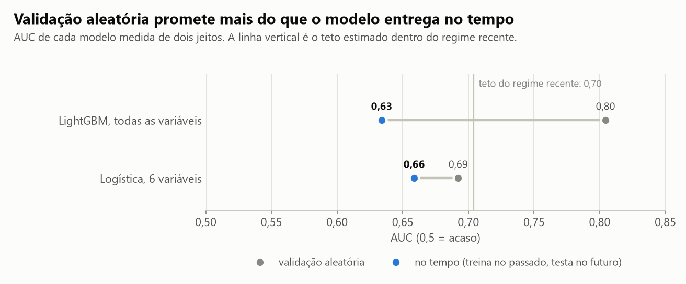
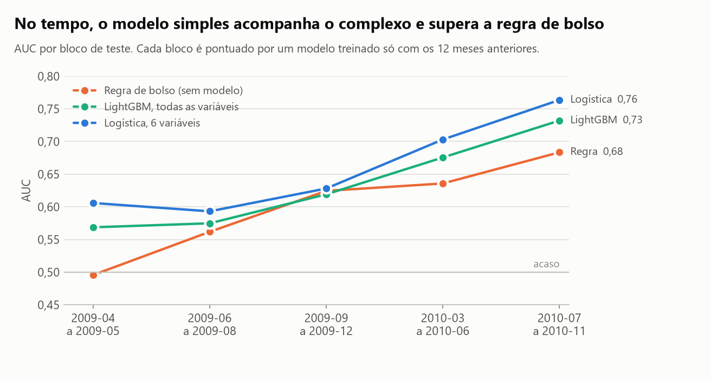
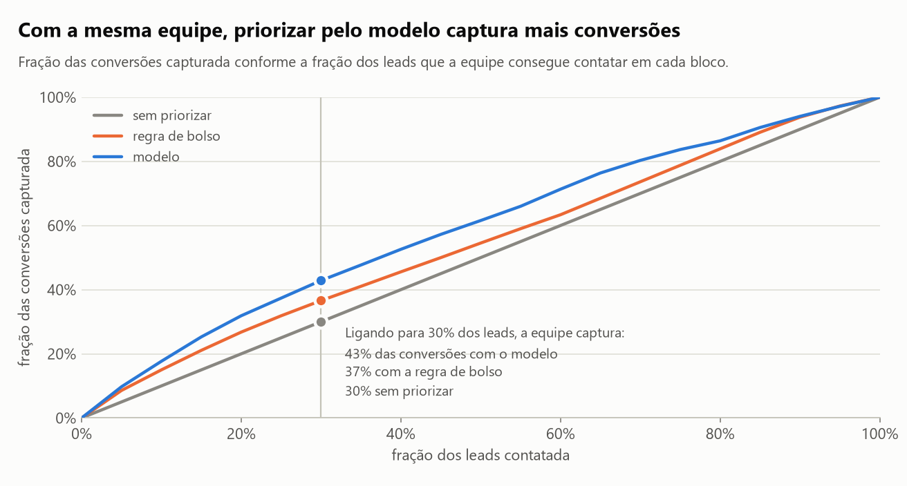
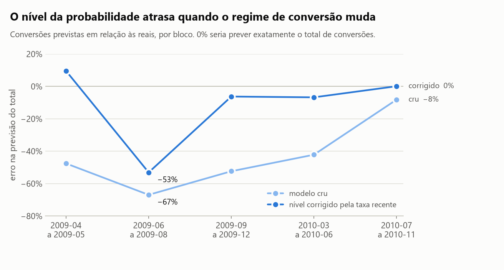

# Para quem ligar primeiro? Previsão de conversão de leads

Uma equipe de televendas recebe mais leads do que consegue contatar. Este projeto constrói e avalia
um score de propensão para ordenar a fila, usando 41.188 contatos reais de telemarketing de um banco
(maio/2008 a novembro/2010).

O resultado mais importante não é o modelo, é a avaliação: **o mesmo modelo que marca AUC 0,80 na
validação "padrão" entrega 0,63 quando é testado como seria usado de verdade**, treinando no passado
e pontuando o futuro.

> **English summary.** Lead scoring on the UCI Bank Marketing dataset (41k telemarketing contacts),
> evaluated the way it would be deployed: walk-forward validation with a 12-month training window.
> Random K-fold reports AUC 0.80; walk-forward shows 0.63 for the same model, because macroeconomic
> features act as a timestamp across a regime change. A 6-feature logistic regression matches
> LightGBM, beats a CRM rule of thumb by 0.06 AUC (95% CI 0.045 to 0.072), and yields about 43% more
> conversions than unprioritized calling when the team can reach 30% of leads. Code and notebook are
> in Portuguese.

## Resultados

| Pergunta | Resposta |
|---|---|
| Quanto a validação aleatória exagera? | LightGBM com todas as variáveis: AUC **0,80** aleatória contra **0,63** no tempo |
| Modelo complexo ou simples? | Logística com 6 variáveis: **0,66** no tempo (IC 95% de 0,65 a 0,67), contra 0,63 do LightGBM |
| O modelo supera uma regra de bolso? | Sim: **+0,06** de AUC (IC 95% de 0,045 a 0,072) |
| Quanto isso vale? | Contatando 30% dos leads: **43% mais conversões** que sem priorizar e **17% mais** que a regra de bolso |
| Onde falha? | No nível das probabilidades: logo após a mudança de regime, o total previsto fica **53% abaixo** do real, mesmo corrigido |

### 1. A validação aleatória promete mais do que o modelo entrega



Os dados mudam de regime: em 2008 a operação liga em massa e converte de 3% a 6%; a partir de
meados de 2009 liga para listas pequenas e converte mais de 35%. Quatro dos cinco indicadores
macroeconômicos do dataset têm um único valor por mês, então funcionam como carimbo de data. Com as
linhas embaralhadas, o modelo aprende a reconhecer o regime pelo carimbo e parece ótimo. No tempo,
o mês seguinte traz valores que ele nunca viu.

O teto de 0,70 é a AUC do modelo completo em validação aleatória restrita ao regime recente: quanto
as variáveis explicam sobre *quem* converte quando *quando* não ajuda.

### 2. Simples empata com complexo e supera a regra de bolso



| Concorrente | AUC no tempo | IC 95% |
|---|---|---|
| Logística, 6 variáveis | 0,659 | 0,646 a 0,672 |
| LightGBM, todas as variáveis | 0,634 | 0,622 a 0,648 |
| Regra de bolso (sem modelo) | 0,600 | 0,588 a 0,613 |

A regra de bolso é o que um gestor faria só com filtros de CRM: primeiro quem já comprou, depois
quem já foi contatado, depois o resto, com celular na frente de telefone fixo.

Ressalva: a configuração escolhida saiu de uma grade de 24 combinações avaliadas nos mesmos blocos,
e as dez primeiras cabem em 0,025 de AUC. A leitura segura é "o modelo complexo não é melhor", não
"o simples é melhor". A grade completa está no notebook.

### 3. O que isso vale em conversões



| Capacidade da equipe | Ligações | Sem priorizar | Regra de bolso | Modelo | Modelo vs sem priorizar | Modelo vs regra |
|---|---|---|---|---|---|---|
| 10% dos leads | 1.321 | 317 | 476 | 562 | +77% | +18% |
| 20% dos leads | 2.644 | 635 | 850 | 1.012 | +59% | +19% |
| 30% dos leads | 3.966 | 953 | 1.162 | 1.361 | +43% | +17% |
| 50% dos leads | 6.610 | 1.588 | 1.731 | 1.954 | +23% | +13% |

Conversões somadas nos cinco blocos de teste (13.216 leads). É um ganho moderado, coerente com uma
AUC de 0,66. Vale a pena porque ordenar a fila custa quase nada, não porque o modelo seja excelente.

### 4. Onde o modelo falha



O score ordena desde o primeiro dia, mas o nível da probabilidade atrasa: treinado em meses de
conversão baixa, o modelo cru subestima o total de conversões em até 67%. Deslocar as probabilidades
para a taxa dos 2.000 leads mais recentes resolve quatro dos cinco blocos (erro de até 10%), mas não
o bloco logo após a virada de regime. Para prever volume de vendas, previsto x realizado por período
precisa ser monitorado.

## Decisões de método

- **Vazamento removido.** `duration` (duração da ligação) só existe depois do contato. Com ela, a
  AUC sobe de 0,69 para 0,88; em produção ela não estaria disponível.
- **Validação walk-forward.** Cinco blocos de teste consecutivos; cada um pontuado por um modelo
  treinado só com os 12 meses anteriores.
- **AUC média por bloco, não agregada.** Juntar blocos com taxas de conversão diferentes premia o
  modelo por acertar o período, não o lead.
- **Incerteza por bootstrap pareado.** 1.000 reamostras dentro de cada bloco, a mesma para todos os
  concorrentes, o que dá o intervalo da diferença entre eles.
- **Empates por valor esperado.** A regra de bolso tem poucos níveis; desempatar pela ordem do
  arquivo (cronológica) a favoreceria.
- **Sem peso de classe.** Reponderar melhora o recall e destrói a calibração.

## Limitações

- Dados de um único banco português, de 2008 a 2010, em plena crise financeira. Os números não se
  transferem para outra operação; o método sim.
- A partir de 2009 o banco já selecionava para quem ligar. O modelo aprende sobre leads que alguém
  já filtrou, e não sabemos como.
- Não há dados de custo por ligação nem de margem por venda, então o ganho está em conversões.
- O score prevê quem tende a converter, não quem converte *por causa* da ligação. Medir venda
  incremental exige experimento ou modelo de uplift.

## Como rodar

Pré-requisito: [`uv`](https://docs.astral.sh/uv/getting-started/installation/).

```bash
uv sync                               # cria o ambiente com as versões travadas
uv run python scripts/baixar_dados.py # baixa o dataset da UCI para data/raw/
uv run python scripts/rodar_analise.py # regera reports/resultados.json e as figuras (~2 min)
uv run pytest                         # 21 testes, não dependem dos dados
```

O notebook [`analise.ipynb`](analise.ipynb) conta a história completa, com as tabelas e a discussão.

## Estrutura

```text
├── analise.ipynb            # narrativa: do dado à conclusão
├── src/lead_scoring/
│   ├── dados.py             # download, reconstrução da linha do tempo, remoção do vazamento
│   ├── features.py          # grupos de variáveis e tratamento do código 999
│   ├── modelos.py           # pipelines: regressão logística e LightGBM
│   ├── avaliacao.py         # AUC, walk-forward, bootstrap pareado, correção de nível
│   ├── negocio.py           # regra de bolso e ganho com capacidade limitada
│   ├── analise.py           # orquestra cada tabela do notebook e do README
│   └── graficos.py          # as quatro figuras
├── scripts/                 # baixar_dados.py, rodar_analise.py
├── tests/                   # 21 testes (pytest)
└── reports/                 # resultados.json e figuras versionados
```

## Dados

Moro, S., Cortez, P. e Rita, P. (2014). *A data-driven approach to predict the success of bank
telemarketing*. Decision Support Systems.
[UCI Machine Learning Repository](https://archive.ics.uci.edu/dataset/222/bank+marketing), licença
CC BY 4.0. O arquivo não é versionado aqui; o script o baixa da fonte.

---

Hélcio Venâncio · [github.com/ghitflux](https://github.com/ghitflux) · Licença MIT

Outros projetos: [`stats-foundations`](https://github.com/ghitflux/stats-foundations) ·
[`ab-test-simulado`](https://github.com/ghitflux/ab-test-simulado)
